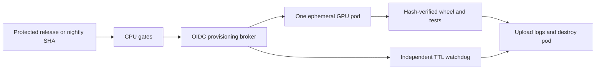

# GPU release and nightly test design

This CLI is CPU-only. Renting a GPU would add no application coverage today.
The requested GPU design below is for a future CUDA-backed component; it is a
design, not an implemented rental integration or a claim that GPU tests ran.

## Placement and test scope

Use one **Runpod Secure Cloud RTX 4090 (24 GB)**, on demand, and destroy the pod
after every job. The provider's pricing page listed **$0.89/GPU-hour** when
checked on 2026-11-12. Inventory, startup time, storage, and the price must be
checked again when provisioning. [Provider pricing](https://www.runpod.io/pricing).

For each release, run after the CPU distribution matrix and before publication.
Install the exact candidate wheel by SHA-256 in a digest-pinned CUDA container.
Run CUDA availability and driver/runtime compatibility checks, a deterministic
small tensor calculation against a CPU reference, representative inference with
fixed small input, numerical tolerance checks, synchronization to expose async
errors, and an explicit VRAM limit. Record GPU model, driver, CUDA, Python,
framework versions, seed, peak VRAM, image digest, wheel digest, and timings.
Allow 20 minutes for tests plus 3 minutes for provisioning and image startup.

Nightly, on the protected default branch, use a ten-minute version of the same
suite plus startup allowance. Rotate supported driver/framework combinations
across nights and run the whole supported compatibility set before release.
Keep small fixtures in a versioned, hash-checked object store. Large downloaded
models, benchmarks, and timing thresholds need separate budgets and baselines.
A single 4090 is not evidence for other architectures, multi-GPU, or 80 GB GPUs.

## Cost assumptions, in USD

| Item | Calculation | Monthly estimate |
| --- | --- | ---: |
| Two releases | 2 x (20 + 3) minutes | 46 minutes |
| Thirty nightly runs | 30 x (10 + 3) minutes | 390 minutes |
| GPU compute | 436 / 60 hours x $0.89 | $6.47 |
| Limited infrastructure retries | 20% of compute | $1.29 |
| Small logs/fixtures allowance | no persistent GPU disk | $1.00 |
| Total | rounded planning budget: $10 | **$8.76** |

The estimate excludes taxes, GitHub private-repo minutes, large model storage,
and substantial egress. Use a $15 monthly provisioning ceiling enforced by the
broker's own metered ledger and an account alert. Provider billing can lag, so an
alert alone is not a hard spending cap. The broker refuses allocations whose
maximum TTL cost would exceed the remaining budget.

## Allocation and cleanup controls

The broker verifies GitHub's OIDC issuer, audience, repository, workflow, event,
ref, and environment. It accepts release tags and the scheduled default branch
only. It holds a scoped provider credential in a secret store; that credential
never reaches the pod. GitHub's PyPI publishing identity is not a Runpod login.
This broker is additional infrastructure that must be built and tested.

Reject failing lint, unit, packaging, or CPU consumer checks before allocating.
Use a single concurrency group; cancel superseded nightlies. Never run fork PRs
on a privileged GPU runner, and do not reuse a self-hosted runner across jobs.
Use a non-root test container without repository or publish credentials. Allow
egress only for the required artifact and results endpoints where supported.

Set a 25-minute release TTL and a 15-minute nightly TTL at the broker. A separate
watchdog reconciles provider resources with the broker ledger and deletes
expired pods even if Actions is canceled or the runner dies. Cleanup must run in
an `always()` path and on cancellation, but that path alone is insufficient.
Test cancellation, API timeout after creation, and failed destruction before
enabling a schedule. If resource creation is ambiguous, reconcile using a unique
allocation ID before retrying; never blindly create a second pod.

Retry a transient allocation/network failure at most once within the budget.
Do not retry test, numerical, OOM, or compatibility failures into a green result.
Fail the release gate when GPU coverage is required and unavailable. Retain
failed logs and report whether failure happened during allocation, setup, or
the actual test.

