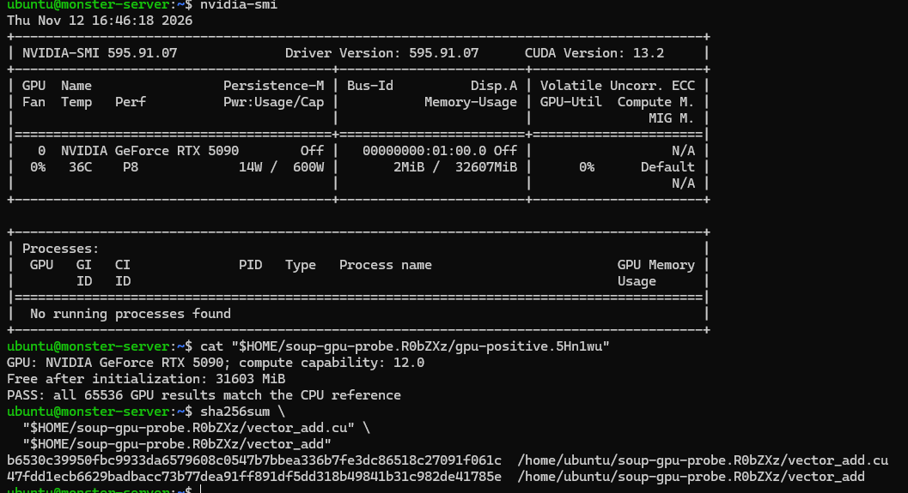

# RTX 5090 lab experiment

## Result and attribution

The applicant manually ran this optional experiment on an existing lab machine
and shared terminal output. Codex supplied the CUDA program and command sequence,
reviewed the reported source/output, and reproduced the source hash locally.
Codex did not connect over SSH or independently retrieve the server-side logs.
The results below are based on that user-reported terminal evidence, not a
signed attestation or a new GitHub Actions run.

This experiment establishes basic container GPU visibility, CUDA execution,
integer-result correctness, normal cleanup, and a CPU-only timeout control on
one machine. It is separate from the historical package CI and published
v0.9.4 release. The CLI remains CPU-only; automated GPU release/nightly jobs and
the cloud allocation broker remain [design work](GPU_CI.md).

## Supporting screenshot



This applicant-supplied screenshot is included unchanged. It shows the current
`nvidia-smi` status, a display of the saved successful program output, and the
source/binary hashes. It does not show the original program exit status, timeout
control, or container-cleanup query; those are transcribed separately below.
The displayed clock belongs to this later capture, not an established test
execution timestamp.

`nvidia-smi` displays CUDA **13.2** as the version supported by the driver. The
test used the recorded CUDA **12.8.2** container and `nvcc` **V12.8.93**; these
are different version fields. See [NVIDIA's driver/toolkit explanation](https://docs.nvidia.com/datacenter/tesla/drivers/cuda-toolkit-driver-and-architecture-matrix.html).

## Recorded environment

| Item | Reported value |
| --- | --- |
| Host | Ubuntu 24.04.5 LTS, x86_64 |
| GPU | NVIDIA GeForce RTX 5090, compute capability 12.0 |
| Driver | 595.91.07 |
| Reported total GPU memory | 32,607 MiB |
| Container engine | Docker snap 29.8.0 with the `nvidia` runtime configured |
| CUDA image tag | `nvidia/cuda:12.8.2-devel-ubuntu24.04` |
| Compiler component | `nvcc` V12.8.93, CUDA release 12.8 |

Immutable image references recorded during the exercise:

- Visibility probe: `ubuntu@sha256:2198e4c65076e9cb0b3d695219df667c0e3b0072da64ca3c2648aca17dcecaf5`
- Compiler and test: `nvidia/cuda@sha256:7fc48a36965c6d0e5c9717dd899b2851cabb2dfef43d95dd12046a2d40bdc90f`

The image tag and compiler component use different version fields. Neither an
image signature check nor a fresh vulnerability audit is claimed here.

## Observed checks

| Check | Reported result | What it establishes |
| --- | --- | --- |
| Container GPU visibility | `nvidia-smi` reported the RTX 5090 and driver inside the pinned Ubuntu container | GPU/driver visibility through the configured runtime, before CUDA computation |
| CPU-only compilation | `nvcc -O2 -std=c++17 -arch=sm_120` produced the binary with `--runtime=runc`, no GPU request and network disabled | The test was compiled for this GPU target; the compiler exit code was not separately captured |
| No-GPU negative control | `--runtime=runc`, `NVIDIA_VISIBLE_DEVICES=void`; program printed the CUDA initialization failure below and exited **1** | Unavailable CUDA access produces failure rather than a false pass |
| GPU correctness | All **65,536** GPU sums matched the CPU reference; program exit **0** | Successful kernel launch, synchronization, result transfer, and exact comparison for this input |
| Normal cleanup | No test container row remained; reported GPU memory returned to **2 MiB used / 32,110 MiB free** | Normal container removal and return to the pre-test memory reading |
| CPU-only timeout control | `/usr/bin/timeout --kill-after=2s 3s /bin/sleep 30` exited **124**; no test container row remained | Ordinary timeout expiry and container cleanup without GPU access |

The negative control printed:

```text
FAIL: device count: CUDA driver version is insufficient for CUDA runtime version
Exit code: 1
```

That message occurred in the deliberately GPU-disabled container. It does not
establish a host-driver compatibility problem.

The positive test printed:

```text
Free GPU memory: 32110 MiB
GPU: NVIDIA GeForce RTX 5090; compute capability: 12.0
Free after initialization: 31603 MiB
PASS: all 65536 GPU results match the CPU reference
Exit code: 0
```

The positive run used `--runtime=nvidia --gpus device=0`, no network, a read-only
mount of the experiment directory, the host user's UID/GID, and an in-container
30-second timeout with a five-second kill grace. A conservative host-side gate
required 2 GiB free before launch. The test allocates three 65,536-element
`int32_t` device buffers: **768 KiB total**, plus CUDA context/runtime overhead.
The program also checks free memory after initialization. These checks do not
reserve capacity against another workload.

An existing model had occupied most VRAM. The applicant unloaded it before the
positive run; a query then showed no compute processes and 2 MiB used. Model
reload/recovery was not confirmed. The before/after readings are snapshots,
not sampled peak-memory measurements or a precise per-process allocation study.

## Integrity, log locations, and retained errors

| Artifact | Reported SHA-256 |
| --- | --- |
| `vector_add.cu` | `b6530c39950fbc9933da6579608c0547b7bbea336b7fe3dc86518c27091f061c` |
| Compiled `vector_add` | `47fdd1ecb6629badbacc73b77dea91ff891df5dd318b49841b31c982de41785e` |

The source listing matched the supplied program. Its hash differed from the
initial snippet only because of one additional final blank line; Codex reproduced
the reported hash with that exact LF-terminated text. The binary hash was supplied
by the applicant and was not independently recomputed on the server by Codex.

Server-side paths supplied by the applicant (not repository links or downloaded
artifacts):

- Negative control: `/home/ubuntu/soup-gpu-probe.R0bZXz/no-gpu.0RSyCF`
- Positive run: `/home/ubuntu/soup-gpu-probe.R0bZXz/gpu-positive.5Hn1wu`
- Timeout control: `/home/ubuntu/soup-gpu-probe.R0bZXz/timeout.6ItkAB`

The terminal transcript also contained `-bash: syntax error near unexpected
token ')'` after the positive program exit and cleanup queries. It is retained
here as a separate unmatched-shell-wrapper paste error, not hidden or counted as
a CUDA failure. No corrected rerun is claimed. Earlier paste display corruption
was checked against the actual source listing and hash before execution.

## Limits and cost

No exact test timestamp, measured elapsed time, throughput, or peak VRAM was
captured. The positive test's timeout was configured but did not expire. The
separate CPU sleep test exercised normal timeout termination; it did not force
the SIGKILL grace path or simulate a hung GPU driver.

This is not validation of PyTorch/framework compatibility, model correctness,
application GPU behavior, multi-GPU support, automated GPU CI, job cancellation,
cloud provisioning, provider cleanup, or the independent watchdog design. It
does not retrofit GPU evidence into the published v0.9.4 release or independently
validate every historical CI result.

The applicant reported no rental charge for using their own lab machine.
Electricity, storage, and operating costs were not measured. This experiment
does not validate or replace the separate RTX 4090 cloud-rental estimate.
See [AI attribution](AI_USAGE.md) and [historical release evidence](../evidence/README.md).

## Reproducible source appendix

The following is the reported source, with LF line endings and one blank line
after the final brace. Saving the fenced contents with those exact bytes
reproduces the source hash above. It was compiled in the digest-pinned image
using `-O2 -std=c++17 -arch=sm_120`; preserve the reported runtime/driver context
when interpreting a new run.

```cpp
#include <cuda_runtime.h>
#include <cstdint>
#include <cstdio>
#include <stdexcept>
#include <string>
#include <vector>

static void check(cudaError_t result, const char* operation) {
    if (result != cudaSuccess)
        throw std::runtime_error(
            std::string(operation) + ": " + cudaGetErrorString(result));
}

struct Buffer {
    int32_t* data = nullptr;
    ~Buffer() { if (data) cudaFree(data); }
    void release() {
        auto* pointer = data;
        data = nullptr;
        check(cudaFree(pointer), "cudaFree");
    }
};

__global__ void add(const int32_t* a, const int32_t* b,
                    int32_t* c, int count) {
    int i = blockIdx.x * blockDim.x + threadIdx.x;
    if (i < count) c[i] = a[i] + b[i];
}

int main() {
    try {
        constexpr int count = 65536;
        constexpr size_t bytes = count * sizeof(int32_t);
        int devices = 0;
        check(cudaGetDeviceCount(&devices), "device count");
        if (devices == 0) throw std::runtime_error("No CUDA GPU available");
        check(cudaSetDevice(0), "select device");

        cudaDeviceProp properties{};
        check(cudaGetDeviceProperties(&properties, 0), "device properties");
        size_t available = 0, total = 0;
        check(cudaMemGetInfo(&available, &total), "memory information");
        std::printf("GPU: %s; compute capability: %d.%d\n",
                    properties.name, properties.major, properties.minor);
        std::printf("Free after initialization: %zu MiB\n",
                    available / (1024 * 1024));

        if (available < 3 * bytes + 64ULL * 1024 * 1024)
            throw std::runtime_error("Insufficient free GPU memory");

        std::vector<int32_t> a(count), b(count), result(count);
        for (int i = 0; i < count; ++i) {
            a[i] = (i % 1024) - 512;
            b[i] = (i % 97) - 48;
        }

        Buffer da, db, dc;
        check(cudaMalloc(reinterpret_cast<void**>(&da.data), bytes), "allocate a");
        check(cudaMalloc(reinterpret_cast<void**>(&db.data), bytes), "allocate b");
        check(cudaMalloc(reinterpret_cast<void**>(&dc.data), bytes), "allocate c");
        check(cudaMemcpy(da.data, a.data(), bytes, cudaMemcpyHostToDevice), "copy a");
        check(cudaMemcpy(db.data, b.data(), bytes, cudaMemcpyHostToDevice), "copy b");

        add<<<(count + 255) / 256, 256>>>(da.data, db.data, dc.data, count);
        check(cudaGetLastError(), "kernel launch");
        check(cudaDeviceSynchronize(), "kernel completion");
        check(cudaMemcpy(result.data(), dc.data, bytes, cudaMemcpyDeviceToHost),
              "copy result");

        for (int i = 0; i < count; ++i)
            if (result[i] != a[i] + b[i])
                throw std::runtime_error("Incorrect result at index " +
                                         std::to_string(i));

        da.release();
        db.release();
        dc.release();
        std::printf("PASS: all %d GPU results match the CPU reference\n", count);
        return 0;
    } catch (const std::exception& error) {
        std::fprintf(stderr, "FAIL: %s\n", error.what());
        return 1;
    }
}

```
